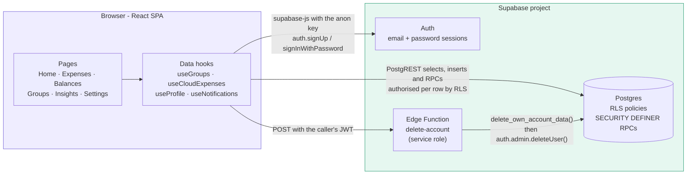
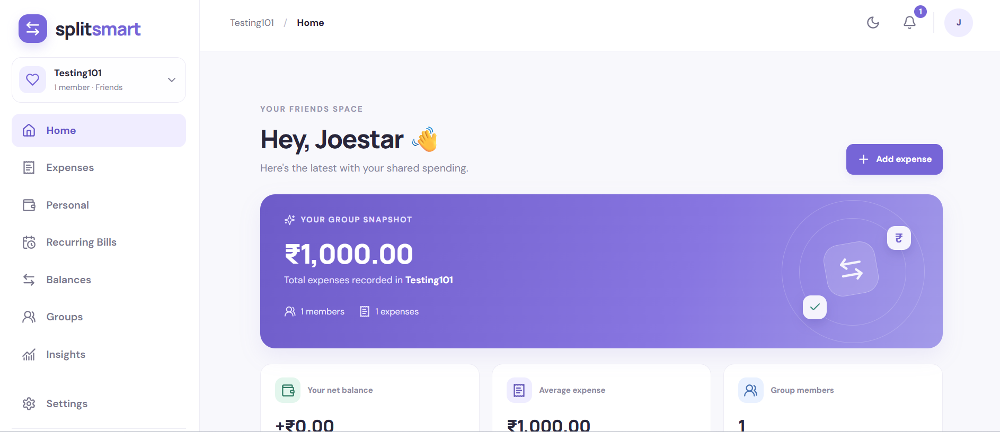
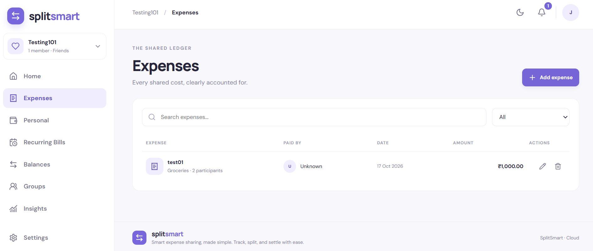
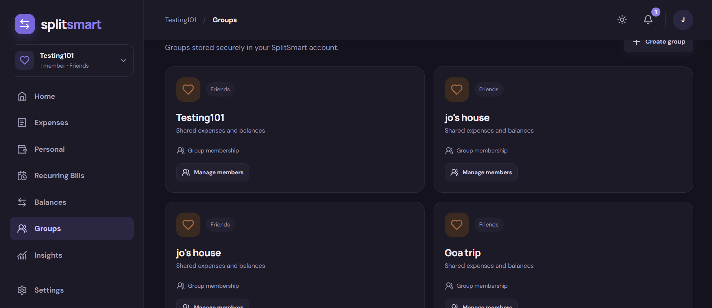

# SplitSmart

**Shared expenses, simplified.**

SplitSmart is a modern expense-sharing application for settling up with the
people you share costs with — flatmates, trips, friends and family. Create
groups, record expenses with flexible splits, see who owes whom, and settle up
with the fewest possible payments.

---

## Table of contents

- [Project overview](#project-overview)
- [Key features](#key-features)
- [Tech stack](#tech-stack)
- [Architecture overview](#architecture-overview)
- [Screenshots](#screenshots)
- [Prerequisites](#prerequisites)
- [Local installation and setup](#local-installation-and-setup)
- [Environment variables](#environment-variables)
- [Supabase setup and migrations](#supabase-setup-and-migrations)
- [Authentication configuration](#authentication-configuration)
- [Running the app and tests](#running-the-app-and-tests)
- [Account deletion Edge Function](#account-deletion-edge-function)
- [Security considerations](#security-considerations)
- [Current limitations](#current-limitations)
- [Future improvements](#future-improvements)
- [Contributing](#contributing)

---


## Project overview

SplitSmart is a single-page application built with **React** and **Vite** that
talks directly to **Supabase** for authentication, data storage and server-side
logic. There is no custom application server in the request path: every read
and write goes through Supabase PostgREST (tables and RPCs) guarded by Postgres
Row Level Security.

The product centres on a shared ledger. Each group has its own expenses,
members and balances; the app turns those raw records into net balances and a
simplified settlement plan, then lets members record payments. On top of the
shared ledger, each account also has a completely private expense tracker,
recurring-bill schedules, in-app notifications and per-user preferences.

Everything is designed so that the database, not the browser, enforces the
rules: membership determines visibility, only the relevant member may act on a
record, and privileged operations (notifications, secure account deletion) run
server-side.

---


## Key features


### Groups and members

- Multiple groups with a type (**Friends, Trip, Home, Family, Office, Custom**)
and optional description; the creator is added as the owner automatically.
- Member directory with roles (owner / admin / member), role changes, member
removal, and leaving a group — all enforced server-side, always keeping at
least one owner.
- Leaving or removing a member is **blocked while they still have an
outstanding balance** in that group.
- One-shot **email invitations** and a single **reusable invite link** per
group. Only a SHA-256 hash of a link token is stored; the raw token is shown
once at creation time.


### Expenses and splits

- Add, edit and delete group expenses with title, amount, category, date,
notes, payer and participants.
- Three split methods: **equal**, **exact amount**, and **percentage**.
- Currency-safe arithmetic — split calculations are performed in paise, and any
rounding remainder from an equal split is distributed deterministically.
- Search and category filtering across the ledger.


### Balances and settlements

- Net balances per member and a **debt-simplification** plan that settles the
group with the fewest transfers.
- Record **full or partial settlements**, with an explicit confirmation step
and a double-submit guard. Payments happen outside the app; recording one
updates the ledger only.


### Recurring bills and personal spending

- Recurring bills with weekly, monthly, quarterly and yearly schedules (plus an
optional end date), payment history, and pause / resume / cancel / delete.
- Nothing is charged automatically: recording a due payment creates a normal
expense through the same database path as any other expense, so balances and
splits stay identical.
- **Personal expenses** — a fully private per-account ledger with search,
category filter and summary. They are never tied to a group and never affect
any group balance.


### Notifications and invitations

- In-app notification bell with an unread count and a dropdown for group
expenses, settlements and invitations.
- Notifications honour your per-user notification preferences, are written only
by database triggers (clients cannot forge or delete them), poll every 60
seconds while the tab is visible, and refresh on window focus.
- Invitations and invite links can be previewed before signing in, accepted
after sign-in, and revoked by an owner or admin.


### Dashboard, insights and preferences

- Home dashboard for the selected group: total spending, your net balance,
average expense, member count and recent expenses.
- Insights page: spending by category and totals paid per member.
- Settings page storing per-user preferences in Supabase — default split
method, notification toggles, recurring-bill reminder lead time and currency
(INR) — restored after a refresh or re-sign-in.
- **Light / dark / system theme** with a one-click moon/sun toggle in the
header, painted before first paint to avoid a flash of the wrong theme.
- **Change password** with a live strength meter and confirmation.


### Account and interface

- **Secure account deletion**: the browser never deletes data itself. It calls
a Supabase Edge Function that re-verifies the session and applies a
server-side deletion policy, blocking the request (with an explanation) while
shared groups or financial history would be affected.
- Loading, error and empty states for every cloud-backed view.
- Responsive desktop and mobile layout with a collapsible navigation drawer; a
compact scrollable sidebar so every item stays reachable on short screens.

---


## Tech stack


| Layer                | Technology                                                                         |
| -------------------- | ---------------------------------------------------------------------------------- |
| UI                   | React 18.3, function components + hooks                                            |
| Build tooling        | Vite 6, `@vitejs/plugin-react`                                                     |
| Styling              | Hand-written CSS (`src/styles.css`), CSS custom properties for theming             |
| Icons                | `lucide-react`                                                                     |
| Backend as a service | Supabase — Postgres with Row Level Security, Auth, PostgREST RPCs, Edge Functions  |
| Client library       | `@supabase/supabase-js` v2                                                         |
| Tests                | Node's built-in test runner (`node --test`), pure-module unit tests                |
| Optional service     | Express 5 + `pg` health-check service in `backend/` (**not used by the frontend**) |


---


## Architecture overview




Key points:

- **The frontend is the only client.** It reads and writes Supabase directly
using the publishable anon key. It never receives a service-role key and
never sends data to the Express service in `backend/`.
- **Authorisation lives in the database.** RLS policies on `groups`,
`group_members`, `expenses`, `expense_shares`, `settlements`, `profiles`,
`notifications`, `personal_expenses` and `user_preferences` decide what each
signed-in account can see or change. Helper predicates such as
`is_group_member()` and `is_group_admin()` read membership only.
- **Sensitive writes go through** `SECURITY DEFINER` **RPCs** created with an empty
`search_path`, explicit `auth.uid()` checks, and revoked `PUBLIC`/`anon`
execute grants — invitations, member management, recurring bills and account
deletion.
- `backend/` **is an optional Express + PostgreSQL service** exposing health
checks only. The SPA does not call it; it is not required to run SplitSmart.

---


## Screenshots



*Dashboard — group total, your net balance, and recent expenses.*



*Expense management — searchable ledger with category filtering.*



*Dark mode — the same interface with the dark theme applied.*

---


## Prerequisites

- **Node.js 18 or newer** (Node 20+ recommended) and npm
- A **Supabase project** (free tier is sufficient)
- **Supabase CLI** — only required to deploy the account-deletion Edge Function
- **Git**

---


## Local installation and setup

```bash
# 1. Clone the repository
git clone <your-repository-url>
cd <your-repository-directory>

# 2. Install dependencies
npm install

# 3. Create a local environment file (see the next section)
#    .env
#    VITE_SUPABASE_URL=https://your-project-ref.supabase.co
#    VITE_SUPABASE_ANON_KEY=your-anon-key

# 4. Start the development server
npm run dev
```

Open the local URL printed by Vite — normally `http://localhost:5173`.

The app reads Supabase configuration at start-up and throws a clear
`Missing Supabase configuration. Check the root .env file.` error if it is
absent, so create `.env` **before** running `npm run dev`.

---


## Environment variables

The frontend uses exactly two variables, both read from a `.env` file in the
project root (`src/supabase.js`):


| Variable                 | Required | Where to find it                                | Purpose                                 |
| ------------------------ | -------- | ----------------------------------------------- | --------------------------------------- |
| `VITE_SUPABASE_URL`      | Yes      | Supabase Dashboard → **Project Settings → API** | Base URL of your Supabase project       |
| `VITE_SUPABASE_ANON_KEY` | Yes      | Same page (Publishable/anon key)                | Client-side key sent with every request |


```bash
# .env — placeholder values only
VITE_SUPABASE_URL=https://your-project-ref.supabase.co
VITE_SUPABASE_ANON_KEY=your-anon-or-publishable-key
```

Notes:

- **Never** put a `SUPABASE_SERVICE_ROLE_KEY` (or any secret) in a `VITE_`
variable. Vite inlines `VITE_*` values into the shipped JavaScript bundle, so
anything prefixed with `VITE_` is public. The service-role key is only ever
used inside the Edge Function's own environment.
- `.env` and `.env.*` are excluded from Git, and `backend/.env` is excluded as
well. `.gitignore` deliberately re-includes `!.env.example` /
`!backend/.env.example`, so a placeholder file can be committed safely if you
want to add one. Never commit real credentials.

---


## Supabase setup and migrations


### Important: how migrations are applied

Migrations are **applied manually, one file at a time, in the Supabase SQL
editor**. This repository contains **no** `supabase/config.toml`, no migration
runner and no CI job that applies SQL, so nothing is applied automatically.
Each file's header comments state this as well.

The files under `supabase/migrations/` are also **incremental**: they extend an
existing schema rather than creating the application from scratch. Objects such
as `public.groups`, `public.group_members`, `public.profiles`, `public.expenses`,
`public.expense_shares`, `public.settlements`, `public.group_invitations`, plus
helpers like `is_group_member()`, `is_group_admin()`, `create_group_expense()`,
`add_group_creator_as_member()` and `handle_new_user()`, are **referenced but not
created** by these files. Start from the Supabase schema this starter targets
(or a schema export of it); applying these migrations to an empty project will
fail on the first missing object.

What *does* happen automatically once the schema and migrations are in place:
profile rows are created by the `handle_new_user()` trigger at signup, group
creators are added as owners by trigger, notifications are written by triggers,
and all access is filtered by RLS.

### Migration checklist (in order)

1. **Create a Supabase project** — Supabase Dashboard → *New project*.
  *(manual)*
2. **Make sure the base schema exists** (the tables and helper functions listed
  above). *(manual — see the note above)*
3. **Configure your local** `.env` with `VITE_SUPABASE_URL` and
  `VITE_SUPABASE_ANON_KEY`. *(manual, local only)*
4. **Apply each migration** in the SQL editor, in filename order:
  *(manual)*

  | #   | Migration                                                  | What it adds                                                                                                                                                                                                                |
  | --- | ---------------------------------------------------------- | --------------------------------------------------------------------------------------------------------------------------------------------------------------------------------------------------------------------------- |
  | 1   | `20261014_group_member_directory.sql`                      | `list_group_members()` — member directory RPC that joins profiles and requires caller membership                                                                                                                            |
  | 2   | `20261015_group_invitations_membership.sql`                | Invitation and member-management RPCs (`create_group_invitation`, `get_invitation_preview`, `accept_group_invitation`, `revoke_group_invitation`, `list_group_invitations`, `remove_group_member`, `set_group_member_role`) |
  | 3   | `20261016_fix_accept_group_invitation_ambiguity.sql`       | Fixes the `column reference "group_id" is ambiguous` error in `accept_group_invitation` — **apply right after #2**                                                                                                          |
  | 4   | `20261017_group_invite_links.sql`                          | Reusable invite links (hashed tokens) plus unified `get_invite_preview` / `accept_invite`                                                                                                                                   |
  | 5   | `20261018_recurring_bills.sql`                             | `recurring_bills`, `recurring_bill_occurrences` and their RPCs                                                                                                                                                              |
  | 6   | `20261019_user_preferences.sql`                            | `user_preferences` table, RLS and `updated_at` trigger                                                                                                                                                                      |
  | 7   | `20261020_personal_expenses_notifications_leave_guard.sql` | `personal_expenses`, `notifications`, notification triggers/helpers, `group_member_net_balance`, and the leave-with-balance guard                                                                                           |
  | 8   | `20261021_appearance_account_security.sql`                 | `user_preferences.theme_mode` and the account-deletion policy functions                                                                                                                                                     |
  | 9   | `20261022_restore_missing_profiles.sql`                    | Idempotent repair: restores missing `profiles` rows and re-asserts the signup trigger                                                                                                                                       |
  | 10  | `20261023_hand_over_group_creator_on_leave.sql`            | Hands `groups.created_by` to a remaining owner/member when someone leaves or is removed, so departed groups stop appearing and cannot be deleted by a non-member                                                              |

   Migrations #1–#10 are additive; several are explicitly idempotent and safe to
   re-run. If a feature's RPC or table is missing at runtime, the corresponding
   migration has not been applied yet.
5. **Configure email confirmation** for development — see the next section.
  *(manual, Dashboard)*
6. **Deploy the** `delete-account` **Edge Function** if you want account deletion to
  work. *(manual, Supabase CLI — see below)*

---


## Authentication configuration

SplitSmart uses Supabase email/password authentication.

**Signup** (`src/AuthGate.jsx`) asks for an email, a password and a password
confirmation. Input is validated before the request is sent
(`src/authValidation.js`, reusing the email rules in `src/inviteUtils.js` and
the password rules in `src/password.js`): a valid email plus a password of at
least 8 characters containing a letter and a number. The client calls
`supabase.auth.signUp({ email, password })` with **no** `emailRedirectTo` and no
OTP.

Profile names are seeded from the signup metadata by the `handle_new_user()`
trigger, falling back to the email local part, so no name is collected at
signup.

**Email confirmation is a Supabase project setting — the client cannot change
it.** By default Supabase emails a confirmation link, in which case `signUp`
returns no session and the app shows an explicit "email confirmation is still
required" message instead of pretending the user is signed in.

To let new users into the app immediately during development:

1. Open your project at [supabase.com](https://supabase.com) → **Authentication**.
2. Go to **Sign In / Providers → Email** (in some versions:
  **Providers → Email**).
3. Turn **OFF** "Confirm email" (a.k.a. "Enable email confirmations").
4. Save.

With confirmation off, `signUp` returns a session and the user goes straight
into the app. No SMTP configuration is needed for this and no secret keys are
involved.

> **This is a development convenience only.** Re-enable email confirmation
> before production, and configure your own SMTP provider if you do.

Login uses `signInWithPassword`, and **Settings → Change password** uses
`supabase.auth.updateUser({ password })` through `src/authActions.js`; no
password is ever stored anywhere in the app.

---


## Running the app and tests

All scripts are defined in `package.json`:


| Command           | What it does                                                        |
| ----------------- | ------------------------------------------------------------------- |
| `npm run dev`     | Start the Vite development server                                   |
| `npm run build`   | Production build into `dist/`                                       |
| `npm run preview` | Serve the production build locally                                  |
| `npm test`        | Run the unit tests with Node's built-in test runner (`node --test`) |


Typical workflow:

```bash
npm run dev      # develop at http://localhost:5173
npm test         # run the test suite
npm run build    # create a production build
npm run preview  # verify the production build locally
```

The suite lives in `tests/` and covers pure, framework-independent modules:
split and balance maths, debt simplification, permissions, balance guards,
mappers, invitations, notifications, preferences, password rules, theme
resolution and account-deletion helpers. There is no browser/UI test runner
configured.

> `backend/` has its own `package.json` with `npm start` / `npm run dev`
> (Express health checks against `DATABASE_URL`). It is **optional** — the
> frontend does not use it.

---


## Account deletion Edge Function

Deleting an account is intentionally **not** a client-side hard delete. The
browser calls the `delete-account` Edge Function
(`supabase/functions/delete-account/index.ts`), which:

1. verifies the caller's JWT with an anon client,
2. runs `public.delete_own_account_data(uuid)` using the **service-role** key,
  and
3. only if that succeeds, removes the auth user with
  `auth.admin.deleteUser`.

Deploy it with the Supabase CLI, from the project root:

```bash
supabase functions deploy delete-account
```

- `SUPABASE_URL`, `SUPABASE_ANON_KEY` and `SUPABASE_SERVICE_ROLE_KEY` are
injected automatically by the Edge Functions runtime — do not hard-code them
and never expose the service-role key to the browser.
- The function keeps the default `verify_jwt` behaviour, so requests must carry
a valid Supabase JWT.
- Requires migration `20261021_appearance_account_security.sql`, which defines
`delete_own_account_data` (granted only to `service_role`),
`my_account_deletion_status` (granted to `authenticated`) and the internal
`_account_deletion_report` (revoked from all API roles).
- **Deletion can be blocked.** The policy deletes only groups where you are the
sole member (cascading their private records) plus your own private rows, and
reassigns non-financial `created_by` metadata on surviving groups. While you
are still a member of a shared group or hold shared expense/settlement
history, the function returns **409** with a list of blockers and changes
nothing. It never modifies another member's data or balance.
- If you skip this step the rest of the app still works; the Delete Account
dialog simply reports the error returned by Supabase.

---


## Security considerations

- **Row Level Security is enabled** on all application tables and is never
disabled. Visibility is driven by group membership; a signed-in account can
only read and change its own rows (`profiles`, `user_preferences`,
`personal_expenses`, `notifications`).
- **Only publishable keys reach the browser.** `VITE_SUPABASE_URL` and
`VITE_SUPABASE_ANON_KEY` are the only frontend variables. The service-role
key exists solely in the Edge Function environment.
- **Privileged operations run server-side** as `SECURITY DEFINER` functions
with `set search_path = ''`, explicit `auth.uid()` checks, and revoked
`PUBLIC`/`anon` execute grants. Notification helpers and triggers are not
executable by clients, and `notifications` deliberately has no `INSERT` or
`DELETE` policy, so users cannot forge or erase alerts.
- **Invitation tokens are hashed.** Invite links store only a SHA-256 hash of a
random token; email invitations are one-shot and still enforce the invited
email match. Both paths require a signed-in, email-verified account.
- **Authorisation is checked in the database, not the UI.** UI affordances are
a convenience only. Never treat a client-generated invite token, a cached
payload or a hidden button as trusted for production authorisation —
generate and validate invitations on the server with expiry and revocation,
and only add a member after an authenticated acceptance flow.
- **Secrets stay out of Git.** `.env`, `.env.`* and `backend/.env` are
ignored; only placeholder `.env.example` files are permitted to be committed.
- **Passwords** are handled exclusively by Supabase Auth; the app stores none.

---


## Current limitations

This is a frontend MVP backed by Supabase; group data is stored per signed-in
account and shared only with that group's members.

- **Migrations are manual and incremental** — there is no migration runner, and
the core schema is not part of this repository (see
[Supabase setup and migrations](#supabase-setup-and-migrations)).
- **INR only.** Every amount is stored and computed in rupees; the currency
display is read-only and multi-currency would need a schema change.
- **No email or push delivery.** Notifications are in-app only; the recurring
reminder lead time is saved per user but nothing is scheduled or delivered,
and there are no background jobs.
- **No automatic payments.** Recurring bills only create an expense when a
member records the payment; settlements are recorded by the payer directly
into `public.settlements`, where RLS only lets the signed-in user act as the
payer.
- **The Express service in** `backend/` **is unused** — the SPA talks to Supabase
directly and never sends data to it.
- **Chosen preferences apply from the next action**, not retroactively: the
default split method is applied when you open Add Expense.
- **Account deletion requires the Edge Function to be deployed**; otherwise the
feature reports a server error.
- **Tests cover pure logic only** — there is no end-to-end or component test
runner configured.
- **No deployment configuration** is included for the frontend.

---


## Future improvements

- Introduce a typed API/service layer in front of Supabase so every call site
shares validation, error handling and authorisation rules.
- Use Supabase Realtime to push group, expense, balance and settlement updates
to all members instead of polling.
- Add invitation expiry, rotation and server-side rate limiting, and move
remaining client-side checks into the database.
- Schedule recurring-bill reminders and deliver notifications by email or push.
- Support multiple currencies with a per-group currency and consistent
rounding rules.
- Add integration and end-to-end tests, structured logging, and a deployment
pipeline for the frontend and Edge Functions.
- Code-split the bundle (it currently ships as a single chunk) and add
performance budgets.

---


## Contributing

Contributions are welcome. To keep changes reviewable:

```bash
npm test         # must pass
npm run build    # must succeed
```

Open a pull request describing the change and how you verified it. Please do
not commit secrets, real `.env` files, or generated build output (`dist/`).